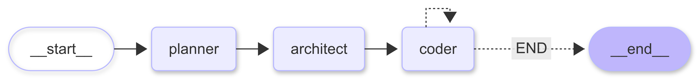

**Assignment 2 – Artificial Intelligence, FJWU**

Submitted by: Sidra Iftikhar | Instructor: Dr. Irum Matloob

> This project is based on the tutorial by **codebasics**:
> ["Agentic AI Project in LangGraph | Build Lovable Clone"](https://youtu.be/SP-b_G74Nuk)

### My changes
- Created the virtual environment with Python 3.12 (using `uv`) because Python 3.14 caused compatibility problems
- Fixed the import in `agent/graph.py`: `langchain.globals` → `langchain_core.globals`
- Fixed the generated calculator: removed `export { Calculator };` from `script.js` so the buttons work

### Result
Prompt: *"Create a simple calculator web application"*

The Planner, Architect and Coder agents generated a working calculator (`index.html`, `script.js`, `style.css`). Tested with 7 × 6 = 42.

---

# 🛠️ Coder Buddy

**Coder Buddy** is an AI-powered coding assistant built with [LangGraph](https://github.com/langchain-ai/langgraph).  
It works like a multi-agent development team that can take a natural language request and transform it into a complete, working project — file by file — using real developer workflows.

---

## 🏗️ Architecture

- **Planner Agent** – Analyzes your request and generates a detailed project plan.
- **Architect Agent** – Breaks down the plan into specific engineering tasks with explicit context for each file.
- **Coder Agent** – Implements each task, writes directly into files, and uses available tools like a real developer.

<div style="text-align: center;">
    
</div>

---

## 🚀 Getting Started
### Prerequisites
- Make sure you have uv installed, follow the instructions [here](https://docs.astral.sh/uv/getting-started/installation/) to install it.
- Ensure that you have created a groq account and have your API key ready. Create an API key [here](https://console.groq.com/keys).

### ⚙️ **Instsllstion and Startup**
- Create a virtual environment using: `uv venv` and activate it using `source .venv/bin/activate`
- Install the dependencies using: `uv pip install -r pyproject.toml`
- Create a `.env` file and add the variables and their respective values mentioned in the `.sample_env` file

Now that we are done with all the set-up & installation steps we can start the application using the following command:
  ```bash
    python main.py
  ```

### 🧪 Example Prompts
- Create a to-do list application using html, css, and javascript.
- Create a simple calculator web application.
- Create a simple blog API in FastAPI with a SQLite database.

---
Copyright©️ Codebasics Inc. All rights reserved.
